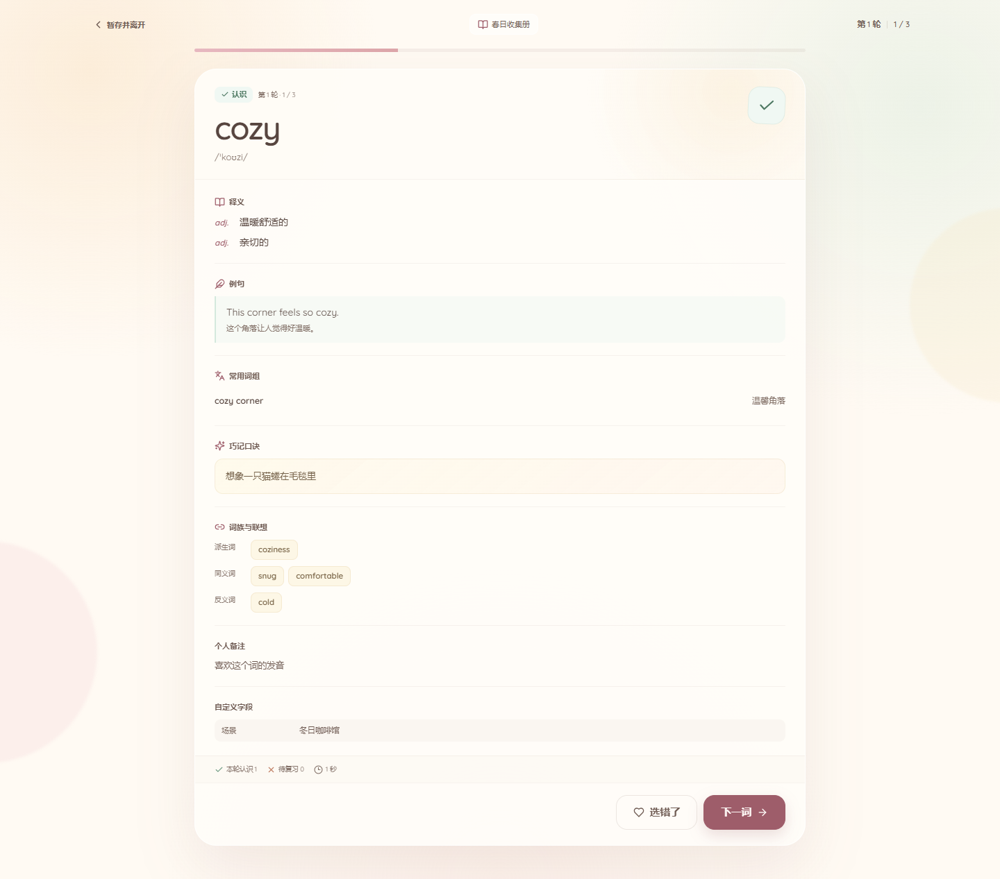

# 丘丘背单词 · Qiuqiu Words

一个完全本地、离线的自定义英语单词学习 Web App。

没有内置词库，没有账号，没有服务器，也不会上传任何数据。词库、单词、判断结果、学习队列与统计都保存在浏览器自己的 IndexedDB 里。

> 给她的一句话：`start-mac.command` 双击打开；所有单词都只留在她自己的电脑上。Windows 上同理，双击 `start-windows.cmd`。

## 预览


<p>
  
  
</p>

---

## 快速开始（macOS，日常使用）

1. 把整个 `丘丘背单词` 文件夹放在一个固定的地方（例如「文稿」里），不要只移动启动脚本。
2. 双击 `start-mac.command`。
3. 浏览器会自动打开 `http://127.0.0.1:17898/`。
4. 第一次打开时，如果 macOS 提示「无法验证开发者」：
   - 在 Finder 里右键 `start-mac.command` → **打开** → 再次点 **打开**；
   - 或打开「系统设置 → 隐私与安全性」，在底部选择「仍要打开」。
   - 仍然不行时，在终端执行一次：
     ```bash
     chmod +x start-mac.command
     xattr -dr com.apple.quarantine "/path/to/丘丘背单词"
     ```
     （把路径换成实际文件夹路径。）
5. 启动后会出现一个终端窗口，它正在提供本地网页服务。**最小化即可，不要关闭**；关闭终端或按 `Control + C` 就停止服务。学习数据已经写入浏览器，不受影响，下次再双击启动即可。

启动脚本会优先使用随包附带的本地小服务（macOS 版本），没有时再依次尝试 Python 3、Ruby 或 Node.js。网页完全离线，只监听 `127.0.0.1`。

### 重要：固定用同一个地址和浏览器

- App 的数据按浏览器来源存储。请始终通过启动脚本打开 `http://127.0.0.1:17898/`。
- 换端口、换浏览器（例如 Safari 换成 Chrome）会看到不同的数据。
- 不要把本地网页直接拖进浏览器（`file://`），也不要用无痕窗口。
- 在 Safari 中可以通过「文件 → 添加到程序坞」把当前网页做成一个像 App 一样的入口，但请保留原地址。
- 定期在词库菜单里导出 JSON 保存单词内容。浏览器清除网站数据会删除 IndexedDB 中的全部学习记录。

### 为什么需要启动脚本

这个项目用 IndexedDB 保证自动保存与崩溃恢复的可靠性。直接双击 HTML（`file://` 来源）时，Safari 的 IndexedDB 限制较多；通过本机 `127.0.0.1` 打开，数据归属固定，刷新和重启浏览器都能恢复。

---

## 快速开始（Windows，日常使用）

可以，在这台 Windows 电脑上也能直接使用；它和 macOS 版是同一个 App。

1. 在完整项目文件夹里双击 `start-windows.cmd`。这个启动器会优先使用随项目附带的 Windows 本地小服务，不要求安装 Python 或 Node.js。
2. 浏览器会自动打开 `http://127.0.0.1:17898/`。
3. 保留命令行窗口（最小化即可）。关闭窗口或按 `Ctrl + C` 会停止本地服务；数据已经保存在浏览器里，下次再启动即可。
4. 如果 Windows SmartScreen 拦截，点「更多信息」→「仍要运行」。
5. 也可以从 GitHub Releases 下载打包好的 Windows 版本，解压后双击 `start-windows.cmd`。

Windows 和 Mac 的数据不会自动同步，因为数据只存在各自的浏览器里。迁移时请用词库里的 CSV / JSON 导出；注意 JSON 只包含单词内容，不包含学习进度与历史。详细说明见 [`使用说明-Windows.md`](使用说明-Windows.md)。

### 版本更新

当前版本为 **v1.4.2**，显示在页面页脚。以后每次更新都会同步更新 `package.json`、页脚版本号和发行包文件名。

更新时只需要：

1. 先关闭正在使用 App 的标签页（可选，但推荐）；
2. 用新发行包替换旧的 `丘丘背单词` 文件夹；
3. 双击新文件夹里的启动脚本。

启动脚本会自动检测并关闭占用 `17898` 端口的旧版服务，然后启动当前文件夹里的新版。**不需要再手动去找旧终端窗口**。浏览器数据在 IndexedDB 里，正常替换文件夹不会丢失；不要清除浏览器网站数据，也不要用无痕窗口。

启动脚本还会在打开的地址后自动加一个随机的 `?v=...` 参数，用来绕过某个浏览器残留的旧页面缓存。这个参数不会改变数据归属，学习记录仍然保存在原来的 IndexedDB 里。

> 如果页脚版本号没有变化，说明仍然打开了旧服务或旧文件夹里的启动脚本。请确认双击的是新文件夹里的 `start-mac.command` / `start-windows.cmd`。如果是手动打开旧书签，可以在地址后加上 `?v=1.2.1`。

---

## 开发与构建

要求：Node.js 20.19+（建议 22 LTS）与 npm。

```bash
npm install
npm run dev        # 开发预览 http://127.0.0.1:5173
npm run build      # 类型检查并构建到 dist/
npm run preview    # 预览生产构建
npm test           # Vitest：导入导出 + 学习引擎 + 数据一致性测试
```

Windows 下也可以直接双击 `start-windows.cmd` 打开已构建版本；打包好的 Windows / macOS 发行包分别由 `python tools/package-windows.py` 和 `python tools/package-mac.py` 生成到 `release/`。

### 目录结构

```text
src/
  db/                 IndexedDB（Dexie）数据库、仓储与学习引擎
  lib/                单词规范化、CSV/JSON 导入导出、工具函数
  components/         模态框、表单、抽屉、提示、导航等
  pages/              首页、词库、单词管理、学习、统计
  styles/             奶油马卡龙设计系统与响应式样式
launcher/
  server/main.go      本地静态服务（Go，交叉编译为 macOS / Windows）
  serve.mjs           Node.js 备用静态服务
  qqwords-server-*    随包附带的本地服务可执行文件
start-mac.command     macOS 一键启动
start-windows.cmd     Windows 一键启动
使用说明.md           给使用者的中文说明（macOS）
使用说明-Windows.md   给使用者的中文说明（Windows）
tools/                生成 macOS / Windows 发行包的脚本
dist/                 构建输出（npm run build 生成，不提交到 Git）
```

### 上传到 GitHub

项目已经准备好 `.gitignore` 和 `.gitattributes`：

- `node_modules/`、`dist/`、`release/` 不会提交；
- 大型 PDF、临时文件、日志和构建缓存不会提交；
- `launcher/` 下的本地服务可执行文件需要保留，一键启动脚本会用到。

```bash
git init
git add .
git update-index --chmod=+x start-mac.command
git commit -m "Initial commit"
git branch -M main
git remote add origin https://github.com/你的用户名/你的仓库.git
git push -u origin main
```

如果使用 GitHub Desktop，直接添加当前文件夹并提交即可，它会读取 `.gitignore`。

发布包不要塞进仓库历史，可以单独上传到 GitHub Releases：

- `python tools/package-mac.py`
- `python tools/package-windows.py`

---

## 导入文件：CSV 加单词，JSON 加词库

职责已经分开：

| 文件 | 只负责 | 在哪里导入 |
| --- | --- | --- |
| **CSV** | 往一个已有词库中添加 / 更新单词 | 进入词库 → 「导入」→「导入 CSV 单词」 |
| **JSON** | 批量添加一个或多个完整词库（含标签、描述） | 「我的词库」→「导入 JSON 词库」 |

- CSV 不能创建词库，也不能设置词库标签；
- JSON 不在词库内部单独导入单词；
- 完整的字段说明、转换方法和示例见 [`词库格式说明.md`](词库格式说明.md)。

## CSV 批量导入单词

在 App 内点击「下载 CSV 模板」可获得带示例的文件。默认表头如下，只有 `word` 是必填。

| 列名 | 内容 | 可识别的中文别名 |
| --- | --- | --- |
| `word` | 英文单词 | 单词、英文、英文单词、english、term |
| `phonetic` | 音标 | 音标、ipa |
| `definitions` | 词性与释义 | 释义、词性释义、中文释义、meaning、中文 |
| `part_of_speech` | 单独的词性列 | 词性、pos |
| `examples` | 例句与翻译 | 例句 |
| `phrases` | 词组与释义 | 词组、短语 |
| `mnemonic` | 巧记口诀 | 巧记、口诀、巧记口诀 |
| `derivatives` | 派生词 | 派生词、派生 |
| `synonyms` | 同义词 | 同义词 |
| `antonyms` | 反义词 | 反义词 |
| `note` | 个人备注 | 备注、个人备注 |
| `custom_fields` | 自定义字段 | 自定义字段、自定义 |

### 单元格友好格式

- 多个释义：用 `|` 分隔，每一项可带词性前缀：
  `n. 苹果 | v. 珍视`
- 多个例句：用 `||` 分隔；每条英文与中文用 `::` 分隔：
  `I eat an apple. :: 我吃一个苹果。||An apple a day. :: 一天一苹果。`
- 多个词组：与例句相同：
  `apple pie :: 苹果派 || the apple of my eye :: 至爱之人`
- 派生词 / 同义词 / 反义词：用 `|` 分隔：
  `apple | fruit | orchard`
- 自定义字段：每条为 `字段名 :: 内容`，多条用 `||` 分隔：
  `出处 :: 一本散文 || 场景 :: 早餐`
- 任何未识别的额外列都会自动成为该单词的自定义字段。
- 复杂字段也接受 JSON 单元格，例如：
  ```json
  [{"partOfSpeech":"n.","meaning":"苹果"}]
  ```
- 当导出内容里包含分隔符时，App 会自动在单元格里使用 JSON，确保 CSV 再导入时不丢失内容。
- 文件建议使用 UTF-8（带不带 BOM 都可以）；也兼容 GB18030 和带 BOM 的 UTF-16。最大 8MB。

### JSON 词库格式

JSON 只用于「我的词库 → 导入 JSON 词库」，负责创建新词库，不会进入某个词库内部添加单词。

推荐使用合集结构：

```json
{
  "app": "qiuqiu-words",
  "version": 2,
  "kind": "library-bundle",
  "libraries": [
    {
      "name": "我的词库",
      "description": "可选描述",
      "tags": ["考研", "阅读"],
      "words": [
        {
          "word": "apple",
          "definitions": [{ "partOfSpeech": "n.", "meaning": "苹果" }]
        }
      ]
    }
  ]
}
```

- 每个词库只需 `name` 和 `words`；
- 每个单词只需 `word`，其他字段可以省略；
- 单个词库导出的 JSON 也可以从这个入口导入；
- 导出文件只包含词库信息（含标签）与单词内容，不包含学习状态、轮次和统计历史。

完整示例和未来转换方法见 [`词库格式说明.md`](词库格式说明.md) 与 [`samples/词库合集示例.json`](samples/词库合集示例.json)。

---

## 分享多个词库 · 一键导入

你可以先在自己的 App 里建好多个词库，然后一次性分享给别人。

1. 在「我的词库」页右上角点 **导出全部**。
2. 会得到一个文件：`丘丘背单词-词库合集-日期.json`。
3. 把这份 JSON 发给对方。
4. 对方在「我的词库」点 **导入 JSON 词库**，选中这个文件，确认后即可一次导入全部词库。

<figure>
  
  <figcaption>导入前会展示词库、单词数量和异常提示；最后一步点「导入」即可。</figcaption>
</figure>

**规则说明**

- 一次导入的多个词库会作为新词库写入，不覆盖已有内容。
- 遇到同名词库时默认自动改名为「原名（导入）」「原名（导入 2）」等；导入预览里也可以选择覆盖同名词库。
- 覆盖会更新词库描述、标签和单词；同名单词保留学习状态，文件里没有的旧单词及其状态会删除；有进行中学习的词库不能覆盖。
- 导入合集时会保留重复单词，不静默删除词条；如果某个单词在合集里出现多次，它们会一起进入词库。
- 合集只包含词库与单词内容，**不包含学习进度、轮次和统计历史**。
- 导入采用一次数据库事务；写入失败不会留下不完整的词库。
- 单个词库的 JSON 导出也能被这个入口读取。

---

## 功能概览

- **完全自定义词库**：创建、重命名、描述、标签、搜索；支持按标签筛选，按首字母、最近修改或最近创建排序；已完全掌握的词库会自动排在最后；支持单个删除和批量删除。
- **灵活单词结构**：英文必填；音标、多组词性释义、多条例句、词组、巧记、派生词、同义词、反义词、备注，以及任意自定义字段。词库详情页的释义也会显示词性。
- **职责清晰的批量迁移**：CSV 只负责往已有词库添加 / 更新单词，JSON 只负责批量创建词库；CSV / JSON 均可导出。
- **词库合集分享**：一键导出全部词库为一个 JSON，对方一键导入多个词库；词库标签会一起保留；同名词库默认改名保留，也可以选择覆盖；导入合集时不会静默删除重复单词。
- **学习会话**：随机固定队列，逐词「认识 / 不认识 / 已熟练掌握 / 上一词」。选择词库时支持搜索和标签筛选，并单独显示「上次学习」的词库。
- **键盘操作**：学习页支持左右方向键。`→` 在答题时选「认识」，在详情页进入「下一词」；`←` 在答题时选「不认识」，在详情页执行「选错了」。
- **遗忘曲线式循环**：每轮只把本轮最终判断为「不认识」的词带入下一轮；全部认识才通关。
- **选错了**：反转当前单词在该轮的判断，立即保存、立即更新轮次统计。
- **学习次数**：每个词库会显示真正的学习次数——按发生过实际判断的会话计数，而不是轮数。
- **自动保存与恢复**：队列顺序、当前轮次、当前单词位置、详情状态、判断记录、轮次总结全部持久化；刷新、关浏览器、电脑重启后从首页继续。
- **学习统计**：真实数据驱动的累计学习词数、完成会话 / 轮次、各词库情况、最近记录和反复答错词。词库、错词和最近记录默认只展示前 10 条，可点「查看全部」；最近学习记录可以单条删除，只删历史，不动单词内容和学习状态。
- **本地与外带**：无网络请求、无跟踪、无账号；数据与学习逻辑都在本机。

### 批量管理词库

在「我的词库」工具栏点 **批量管理**，勾选多个词库后点 **删除所选**。删除仍然需要两步确认，并会明确提示：

- 这些词库中的单词和单词内容会一起删除；
- 这些单词的认识 / 不认识 / 熟练掌握状态会一起删除；
- 正在进行的相关学习会话会终止；
- 已完成的学习历史与统计会保留，词库名称以删除时的快照显示。

词库列表可以在工具栏切换排序方式：

- **首字母顺序**：按名称排序（中文按拼音）；
- **最近修改**：最近更新过的词库在前；
- **最近创建**：最新创建的词库在前。

无论选择哪种排序，**已完全掌握的词库都会放在最后**。排序偏好会保存在当前浏览器中。导出的词库合集仍按名称排列。

### 标签筛选

新建或编辑词库时可以添加标签，例如「考研」「雅思」「阅读」「待复习」。每个词库最多 12 个标签，每个标签最多 20 个字符。

- 词库卡片和词库详情页都会显示标签；
- 「我的词库」工具栏可以按标签筛选；
- 直接点击词库卡片上的标签也能快速筛选，再次点击取消；
- 搜索框会同时匹配词库名称、描述和标签；
- JSON 导出、词库合集导入都会保留标签。

### 数据一致性策略

- 单词内容与学习状态分开存储；删除词库会删除其单词与学习状态。
- **已完成的学习会话会保留为历史**，显示删除时的词库名快照；进行中的会话会标记为已中断。
- 学习中的会话使用开始时的单词 ID 顺序快照和固定的轮次队列，不受新增单词影响；编辑单词内容会立即反映在详情页。
- 为了不打断队列，**正在未完成会话中的单词不能删除**；请先完成该会话。
- 每轮每个词只有一个判断值，错词由最终判断状态推导，不使用重复 push 统计。
- 单个删除和批量删除词库都需要两步确认，并明确提示关联数据去向。

---

## 测试

```bash
npm test
```

覆盖：

- CSV / JSON 导入解析与带分隔符内容的无损导出再导入；
- 新建单词与独立学习状态、唯一性约束；
- 跳过 / 更新重复导入；
- 熟练掌握排除、进行中会话复用；
- 判断保存、选错了反转、位置切换、轮次总结；
- 错词进入下一轮、全对通关、统计依据真实数据；
- 活动会话内单词删除保护、单个 / 批量词库删除与历史保留；
- 词库学习次数按会话计数，与轮数区分；
- 多词库合集解析、导出、批量导入、保留重复单词、同名词库自动改名或覆盖、覆盖时保留同名单词状态与事务回滚；
- 词库标签去重、导入导出保留与标签筛选；
- 三种词库排序方式与「已完全掌握置后」规则。

浏览器中的完整交互（创建词库、手动/CSV/JSON 导入、多词库一键导出与导入、学习、键盘操作、刷新恢复、统计详情、批量删除、导出、删除保护）已经过 Edge/Chromium 端到端验证。

---

## 隐私

App 运行时不请求任何外部域名；字体、图标与全部资源都随构建文件离线提供。本地服务只绑定 `127.0.0.1`，同一局域网的其他设备无法访问。
